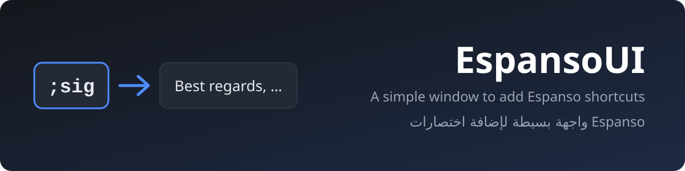
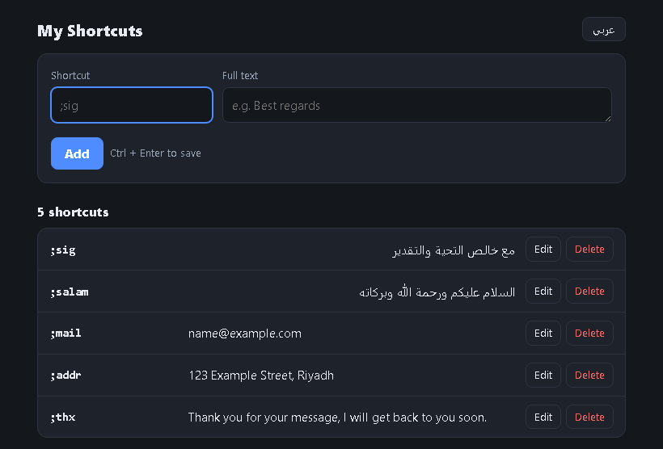
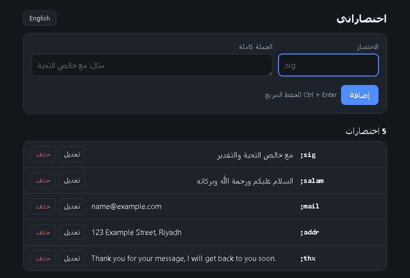

  

  
  
  
  
  
  

# EspansoUI

**A simple window for adding [Espanso](https://espanso.org) text shortcuts without editing YAML by hand.**

One box for the shortcut, one box for the full text, press **Add**, and it works right away in every app.
No more broken config because of a missing space or quote.

  
  

## Why

Espanso is a great text expander, but adding a shortcut means editing `match/base.yml`, and one wrong
indent or quote can stop the whole file from loading. EspansoUI writes that file for you, safely.

## Features

- **Two fields:** the shortcut (e.g. `;sig`) and the full text, plus a list with Edit and Delete.
- **Safe writing:** every value is written quoted, then read back and checked before the file is replaced.
- **Never damages your file:** if `base.yml` contains anything the UI does not understand
  (forms, variables, `|` blocks…), it opens read-only and changes nothing.
- **Automatic backup** before every save (last 50 kept in `%LOCALAPPDATA%\EspansoUI\backups`).
- **Warnings** for duplicate shortcuts and for very short ones (like `am`) that may fire inside normal words.
- **Instant effect:** Espanso reloads the file by itself. No restart.
- **English and Arabic interface:** switch with one click (Arabic is fully right-to-left).
- **Single window:** opening it again brings the existing window to the front.
- **No dependencies:** only Python's standard library. The window is Microsoft Edge in app mode.

## Requirements

- Windows 10 / 11
- [Espanso](https://espanso.org/install/) 2.x
- [Python](https://www.python.org/downloads/) 3.8 or newer
- Microsoft Edge (already installed on Windows)

## Usage

1. Download the code (green **Code** button → **Download ZIP**) and extract it anywhere.
2. Double-click **`app.pyw`**.
3. Type a shortcut, press Enter, type the full text, press **Add** (or Ctrl+Enter).

It edits `%APPDATA%\espanso\match\base.yml`. Other match files and packages are not touched.

## How it works

`app.pyw` starts a tiny local server on `127.0.0.1` (random port, random token, accepts nothing from
other sites) and opens `index.html` in an Edge app window. `espanso_file.py` reads and writes the YAML
with a strict parser. When the window closes, the program exits.

---

## بالعربية

**واجهة بسيطة لإضافة اختصارات Espanso دون تعديل ملف YAML يدويًا.**

خانة للاختصار وخانة للجملة كاملة، ثم زر **إضافة**، فيعمل الاختصار فورًا في كل البرامج.
لا مزيد من توقف Espanso بسبب حرف أو مسافة في غير مكانها.

- **حفظ آمن:** تُكتب القيم بين علامتي تنصيص، ويُتحقق من الملف قبل استبداله.
- **لا يخرّب ملفك:** إن وجد في الملف صيغة لا يفهمها يفتح للقراءة فقط ولا يغيّر شيئًا.
- **نسخة احتياطية تلقائية** قبل كل حفظ، ويُحتفظ بآخر 50 نسخة.
- **تنبيهات** للاختصار المكرر، وللاختصار القصير الذي قد ينطلق وسط الكلمات.
- **واجهة عربية وإنجليزية** بزر واحد للتبديل.
- **نافذة واحدة فقط**، و**بلا أي حزم إضافية**: يكفي Python.

**التشغيل:** نزّل الملفات، ثم انقر مرتين على `app.pyw`.

## License

[MIT](LICENSE) © 2026 Ali Alhumedi

EspansoUI is an independent project and is not affiliated with Espanso.
